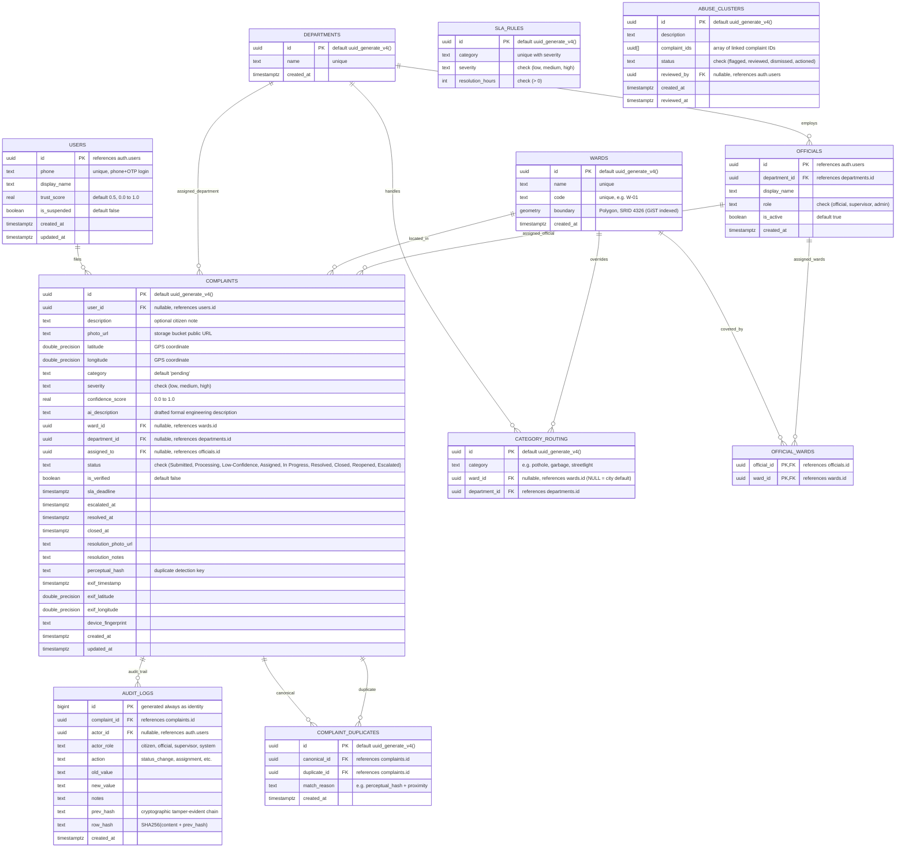
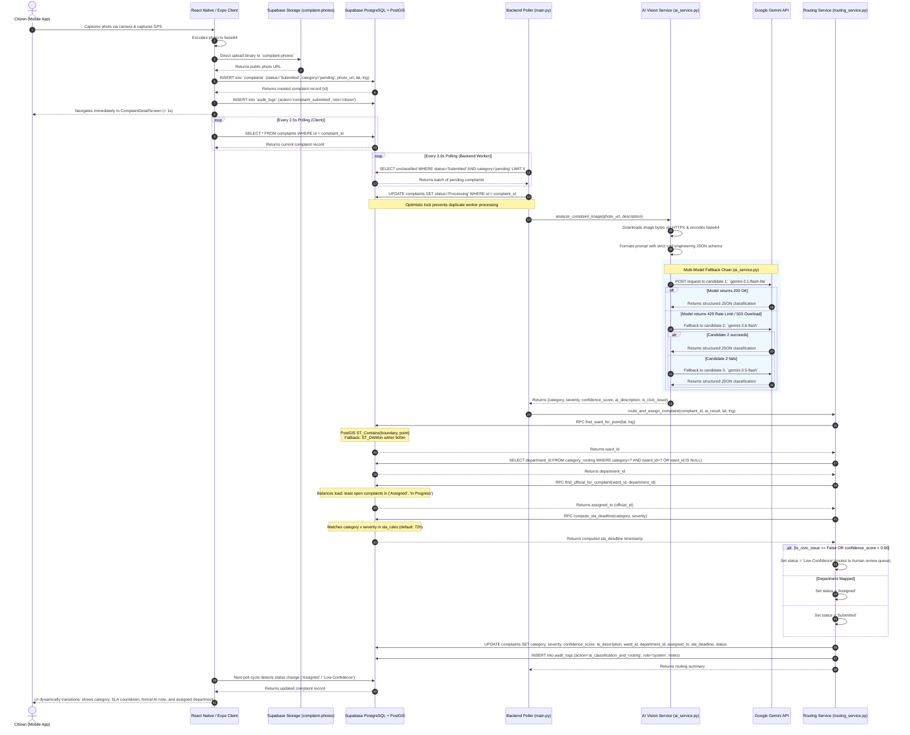

# CivicLens — System Design & Architecture Specification

This document provides a comprehensive technical architecture and design reference for **CivicLens**, an automated municipal grievance triage and geospatial accountability platform. The contents reflect the verified implementation in the codebase.

---

## 1. Architectural Overview

CivicLens adopts a decoupled, event-driven, asynchronous architecture designed for high availability on mobile networks:

1. **Client Tier**: A cross-platform mobile client built using **React Native and Expo**, designed to capture geotagged images directly from hardware sensors.
2. **Cloud Data Tier**: **Supabase (PostgreSQL 15 with the PostGIS extension)** providing relational tables, spatial polygon geometry, binary object storage (`complaint-photos`), and Row-Level Security (RLS).
3. **Autonomous Worker Tier**: A Python backend service built with **FastAPI and Asyncio**, running an autonomous polling daemon that consumes unprocessed complaints, orchestrates **Google Gemini Multimodal Vision AI** for automated classification, and executes **PostGIS point-in-polygon spatial routing**.

---

## 2. Entity-Relationship (ER) Diagram

The following ER diagram is generated directly from [`supabase/schema.sql`](../supabase/schema.sql) and includes every table, column, data type, primary key (PK), foreign key (FK), and relational constraint.

### Database Constraints and Indexes
- **Spatial Indexing**: `idx_wards_boundary` uses a GiST index on `wards.boundary` for point-in-polygon queries. An additional GiST index on `complaints` location (`ST_SetSRID(ST_MakePoint(longitude, latitude), 4326)`) accelerates geographic search.
- **SLA Partial Index**: `idx_complaints_sla` indexes `sla_deadline` specifically on active tickets (`Assigned`, `In Progress`) for background breach detection.
- **Security & RLS**: Row-Level Security is active across all tables. The PostgreSQL function `is_admin()` operates as a `SECURITY DEFINER` function, preventing infinite recursion during administrative permission evaluation.

---

## 3. End-to-End Complaint Pipeline Sequence

The sequence diagram below models the complete lifecycle from citizen intake through cloud ingestion, asynchronous vision AI classification with fallback, PostGIS boundary containment, SLA computation, and mobile client synchronization.

---

## 4. Backend Module Responsibilities

The backend is organized modularly under `backend/`, following single-responsibility and separation-of-concerns principles:

| Module | File Path | Core Responsibilities |
|---|---|---|
| **API Entry & Lifespan Daemon** | [`backend/main.py`](../backend/main.py) | • Initializes the FastAPI application, CORS middleware, and API router. • Manages the application `lifespan` context to spawn and tear down the background polling worker `poll_unprocessed_complaints()`. • Provides endpoints: `POST /api/complaints`, `GET /api/complaints`, `GET /api/complaints/{id}`, `GET /api/complaints/heatmap`, and `POST /api/complaints/{id}/classify`. |
| **Multimodal AI Service** | [`backend/ai_service.py`](../backend/ai_service.py) | • Connects to Google Gemini Multimodal Vision API. • Converts incoming images to Base64 payloads and injects an engineering system prompt with JSON response schemas. • Executes an automatic multi-model fallback chain (`gemini-3.1-flash-lite` $\to$ `gemini-3.6-flash` $\to$ `gemini-3.5-flash`) on HTTP 429/503 errors. • Guards against corrupted image inputs (HTTP 400) and spam/non-civic uploads (`is_civic_issue`). |
| **Geospatial & SLA Routing** | [`backend/routing_service.py`](../backend/routing_service.py) | • Executes PostGIS stored procedure `find_ward_for_point` to resolve coordinates to administrative wards. • Evaluates the hierarchical `category_routing` table (ward-specific overrides first, falling back to city-wide defaults). • Calls `find_official_for_complaint` for load-balanced assignment. • Invokes `compute_sla_deadline` based on configured resolution hour matrices. • Enforces human-in-the-loop triage: routes items with confidence $< 0.60$ or non-civic flags to `Low-Confidence`. • Records state transitions in `audit_logs`. |
| **Database Clients** | [`backend/database.py`](../backend/database.py) | • Instantiates `supabase_admin` with the `SUPABASE_SERVICE_ROLE_KEY` to perform administrative updates, background worker polling, and bypass RLS safely server-side. • Instantiates `supabase_public` using `SUPABASE_ANON_KEY` for public-scoped queries. |
| **Configuration** | [`backend/config.py`](../backend/config.py) | • Implements a cached Pydantic `BaseSettings` object reading from `.env`. • Validates required configurations: `supabase_url`, `supabase_anon_key`, `supabase_service_role_key`, `gemini_api_key`, and `ai_confidence_threshold` (default `0.6`). |
| **Data Schemas** | [`backend/schemas.py`](../backend/schemas.py) | • Defines Pydantic request and response contracts (`ComplaintSubmitResponse`, `ComplaintDetail`, `ComplaintDetailWithAudit`, `ComplaintListItem`, `HeatmapPoint`, `HealthResponse`). • Defines domain enumerations: `ComplaintStatus` and `Severity`. |
