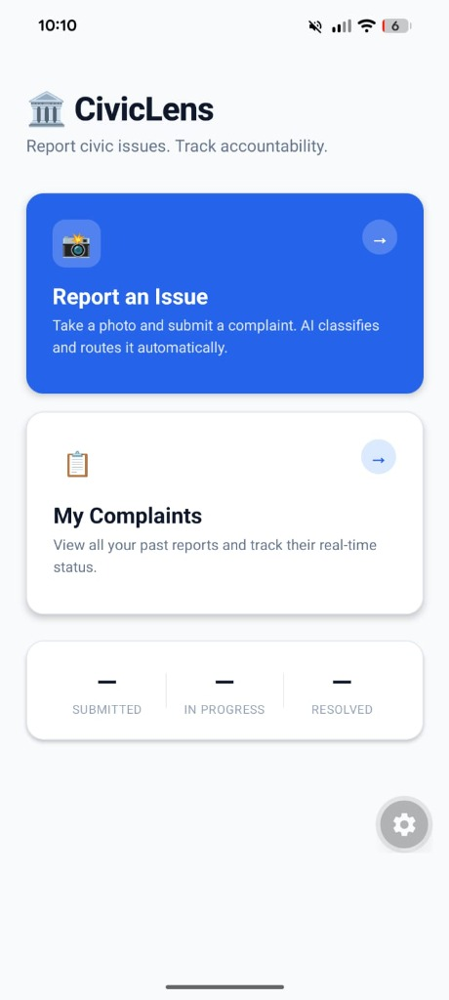

# CivicLens — Citizen User Manual & Operating Guide

Welcome to the **CivicLens** User Manual. This guide walks citizens and evaluators step-by-step through reporting civic grievances (potholes, garbage dumps, non-functioning streetlights, water leaks) and monitoring their resolution lifecycle.

> **Evaluation Transparency Notice**:  
> In accordance with software engineering evaluation standards, this manual clearly distinguishes between **live captured screens** from runtime devices versus **screens described from verified source code** (owing to native mobile sensor requirements like hardware cameras and GPS modules):
> - **Live Screenshot**: [Home Screen](#1-home-screen--dashboard-overview) (`docs/assets/screenshots/home_screen.jpg`)
> - **Described from Source Code**: [Submit Complaint Screen](#2-reporting-an-issue-submitcomplaintscreen), [Complaint Detail Screen](#3-tracking-complaint-progress-complaintdetailscreen), [My Complaints Screen](#4-viewing-complaint-history-mycomplaintsscreen), and [Lightweight Status Screen](#5-lightweight-status-screen-statusscreen).

---

## 1. Home Screen / Dashboard Overview

The **Home Screen** serves as the central hub for citizen interaction. It provides one-tap navigation to report issues or check past reports, while displaying real-time aggregated municipal metrics.

  
*Figure 1: CivicLens Home Screen on mobile runtime (Live Screenshot).*

### Screen Elements & Capabilities:
1. **Brand Identity & Civic Header**: Displays the municipal title and core mission statement (*"Report civic issues. Track accountability."*).
2. **"Report an Issue" Action Card**: A primary blue card launching the camera intake workflow.
3. **"My Complaints" Action Card**: A card opening the historical ticket list.
4. **Live Municipal Metrics Bar**:
   A dynamic stats bar querying the database directly on focus:
   - **SUBMITTED**: Active intake count, including tickets in `Submitted`, `Processing`, and `Low-Confidence` triage.
   - **IN PROGRESS**: Count of verified complaints dispatched to municipal departments (`Assigned`, `In Progress`, `Escalated`, `Reopened`).
   - **RESOLVED**: Successfully addressed complaints (`Resolved`, `Closed`).

---

## 2. Reporting an Issue (`SubmitComplaintScreen`)

*(Described from source code: [`civiclens-app/src/screens/SubmitComplaintScreen.js`](../civiclens-app/src/screens/SubmitComplaintScreen.js))*

This screen implements strict anti-abuse rules and high-speed cloud ingestion to ensure complaints are verified, geotagged, and submitted in under 60 seconds.

### Step-by-Step Citizen Flow:

```
[ Tap 'Report an Issue' ]
            │
            ▼
[ Grant Camera & GPS Permissions ]
            │
            ▼
[ Snap Live Photo ] ──► (Gallery uploads blocked to prevent stock photos)
            │
            ▼
[ Verify Auto-Captured GPS Coordinates ]
            │
            ▼
[ Optional: Enter Description Note ]
            │
            ▼
[ Tap 'Submit Complaint' ] ──► Direct Cloud Push (< 1s) ──► Transitions to Detail View
```

### Detailed Screen Behavior:
1. **Permission Prompts**:
   - Prompts for **Camera Access** via `expo-image-picker`.
   - Prompts for **Foreground Location Access** via `expo-location`.
2. **Live Camera Capture (FR-C2)**:
   - Tapping **"Take Photo"** launches the native camera interface with image optimization (`quality: 0.6`).
   - **Anti-Abuse Guard**: Image selection from the local gallery is deliberately disabled in accordance with requirement **FR-C2** to prevent submission of downloaded, fabricated, or recycled photos.
3. **Hardware GPS Geotagging**:
   - The device location is extracted with balanced GPS accuracy.
   - Coordinates (Latitude & Longitude) are reverse-geocoded into a human-readable street address (e.g., *"Bhadson Road, Patiala, Punjab"*).
   - **Developer/Testbed Switch**: Includes a toggle to lock coordinates to the **Thapar University campus pilot testbed** (`30.3560°N, 76.3570°E`) when evaluating inside an emulator or indoors with obstructed satellite reception.
4. **Optional Citizen Note (FR-C3)**:
   - A multi-line text input allowing up to 400 characters for descriptive details (e.g., *"Deep pothole right in front of the main entrance gate causing traffic hazards"*).
5. **High-Speed Direct Cloud Submission (NFR-1)**:
   - Tapping **"Submit Complaint"** encodes the image to Base64 and streams it directly to Supabase Cloud Storage (`complaint-photos`).
   - The complaint record is created with initial status `Submitted` and category `pending`.
   - The citizen is navigated to the ticket status screen in under **1 second**, eliminating long loading spinners.

---

## 3. Tracking Complaint Progress (`ComplaintDetailScreen`)

*(Described from source code: [`civiclens-app/src/screens/ComplaintDetailScreen.js`](../civiclens-app/src/screens/ComplaintDetailScreen.js))*

Once submitted, the citizen lands on this tracking screen. The client uses an autonomous polling loop (every 2.5s) to detect background AI classification and spatial ward routing in real time.

### Key Sections on this Screen:

```
┌────────────────────────────────────────────────────────┐
│  STATUS HEADER: 👤 Assigned (Blue Tint)                │
│  "Routed to Roads & Infrastructure"                    │
├────────────────────────────────────────────────────────┤
│  [ COMPLAINT PHOTO PREVIEW ]                           │
├────────────────────────────────────────────────────────┤
│  LIFECYCLE TIMELINE:                                   │
│  (●) Submitted ──► (●) Assigned ──► (○) In Progress   │
├────────────────────────────────────────────────────────┤
│  AI MUNICIPAL ASSESSMENT:                              │
│  • Category: 🕳️ Pothole    • Severity: [HIGH]          │
│  • Formal Note: "Substantial asphalt subsidence..."   │
├────────────────────────────────────────────────────────┤
│  ROUTING DETAILS:                                      │
│  • Ward: Ward W-01 (Thapar / Bhadson Road)             │
│  • Department: Roads & Infrastructure                  │
│  • SLA Deadline: 24 Hours (Target: Tomorrow, 4:15 PM)  │
├────────────────────────────────────────────────────────┤
│  AUDIT TRAIL:                                          │
│  1. 16:15 - Submitted by Citizen via Mobile            │
│  2. 16:15 - AI Classified & Routed by System           │
└────────────────────────────────────────────────────────┘
```

### Live Behaviors & Edge Cases:
1. **Dynamic Real-Time Update**:
   While the status is `Submitted` or `Processing`, a subtle spinner indicates that the autonomous AI daemon is inspecting the image. Within 2 to 4 seconds, the screen transitions dynamically to `Assigned` without requiring a manual refresh.
2. **Human Triage Notice (`Low-Confidence`)**:
   If a user submits an irrelevant photo (e.g., an indoor keyboard, pet, or selfie) or an image with confidence score $< 0.60$, the AI flags it (`is_civic_issue: false`). The status banner shifts to amber with an alert:
   > ⚠️ **Low-Confidence — Under Review**  
   > *"Flagged as private space or non-civic item. In triage queue for human verification."*  
   This ensures transparency while preventing false municipal dispatches.
3. **Official SLA Clock (FR-S1)**:
   Displays the computed resolution deadline based on the municipal SLA matrix (e.g., 24 hours for High Severity Potholes, 120 hours for Low Severity Garbage).
4. **Immutable Audit Trail (FR-O5 / NFR-8)**:
   Shows every event in the ticket's history with timestamps, actor role (`citizen`, `system`, `official`), and verification notes.

---

## 4. Viewing Complaint History (`MyComplaintsScreen`)

*(Described from source code: [`civiclens-app/src/screens/MyComplaintsScreen.js`](../civiclens-app/src/screens/MyComplaintsScreen.js))*

Citizens can review all their historical complaints in a unified feed accessible from the Home Screen card.

### Screen Features:
- **Card Feed**: Each complaint card displays:
  - Defect thumbnail preview.
  - Category tag and emoji (e.g., `🕳️ Pothole`, `🗑️ Garbage`, `💡 Streetlight`).
  - Status pill with color-coded styling (`Submitted`, `Processing`, `Assigned`, `In Progress`, `Resolved`, `Escalated`).
  - Relative timestamp (e.g., *"Just now"*, *"12m ago"*, *"2d ago"*).
  - Truncated citizen description note.
- **Pull-to-Refresh**: Citizens can pull down on the list to trigger `fetchComplaints()` and retrieve latest status changes from the cloud.
- **Detailed Drilldown**: Tapping any card opens `ComplaintDetailScreen` for full lifecycle inspection.

---

## 5. Lightweight Status Screen (`StatusScreen`)

*(Described from source code: [`civiclens-app/src/screens/StatusScreen.js`](../civiclens-app/src/screens/StatusScreen.js))*

A minimalist status tracker designed for quick lookup via direct complaint ID routing:
- Displays Complaint UUID and original photo.
- Displays a vertical 5-step milestone timeline:
  1. `Submitted`
  2. `Assigned`
  3. `In Progress`
  4. `Resolved`
  5. `Closed`
- Supports pull-to-refresh to verify current state.
